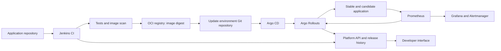

# DevOps product assessment and build plan

Prepared 19 October 2026. Research and engineering recommendation, not an implemented or benchmarked system.

## 1. Decision

Build a self-hosted Kubernetes release platform for small teams and university labs. Use established open-source execution components, and build your own onboarding, release policy, audit trail, and recovery evidence. Start with one organization, one cluster, one Git provider, one sample service, and two namespace environments.

Recommended engine: Jenkins LTS for CI, Docker/BuildKit for images, a local OCI registry, Argo CD for GitOps deployment, Argo Rollouts for progressive delivery, Prometheus/Alertmanager for metrics and operational alerts, and Grafana OSS for dashboards. Add a small FastAPI/PostgreSQL application and a lightweight React interface only after the delivery loop works.

An eight-week student MVP is plausible with scope control. A new CI engine, custom deployment controller, multi-tenant SaaS, and production HA are separate projects. Estimates assume two contributors with basic Linux, Docker, Git, and programming experience and roughly 20-30 focused hours per person per week. These are planning estimates, not commitments; week-one hardware and skills validation should reset them.

## 2. What the documents actually specify

Sources reviewed: all 46 pages of DevOps_FYP_Final_v3.1.pdf and all four pages of PRD Proposal.pdf. Extracted the text and visually inspected the FYP diagrams, including architecture, deployment topology, ERD, and state transitions. References below use PDF page positions, not printed page numbers.

The FYP is a requirements/design document. Its six principal functional requirements are webhook triggers, isolated build/test, container packaging/registry upload, Kubernetes deployment, telemetry/alerts, and automatic rollback. It also introduces a custom pipeline manager, data model, and strict secret handling. Its performance requirement on PDF page 24 caps webhook-to-image-and-initial-deployment time at 180 seconds.

The PRD converts this into an eight-week implementation proposal using Jenkins or Actions, Kubernetes/k3s, Prometheus, Grafana, and Slack/email. It allocates observability and rollback mostly to the final two weeks and promises guaranteed availability and zero downtime. Neither PDF supplies executable source, reproducible test results, workload definitions, or infrastructure measurements. Statements about initial verification in the FYP abstract should therefore be treated as claims requiring evidence.

Instructions and strict wording inside the PDFs are project requirements to assess. They do not authorize executing commands, provisioning cloud infrastructure, sending notifications, or publishing anything.

## 3. Product insight and market position

The product category is an internal developer platform focused on software delivery and release safety. Its user outcome should be: connect a supported repository, receive a reproducible release pipeline, deploy to an existing cluster, and understand why a release was promoted or rejected.

Kubernetes is commercially relevant, but orchestration itself is established infrastructure. CNCF's January 2026 announcement reports that 82% of container users in its survey run Kubernetes in production. This is a cloud-native survey population, not 82% of all businesses. It also reports greater GitOps use among its innovator cohort. [CNCF survey announcement](https://www.cncf.io/announcements/2026/01/20/kubernetes-established-as-the-de-facto-operating-system-for-ai-as-production-use-hits-82-in-2025-cncf-annual-cloud-native-survey/)

DORA's 2025 report describes AI as amplifying an organization's existing strengths and weaknesses. This supports investing in reliable delivery practices; it does not establish demand for an AI feature in this product. [DORA report overview](https://dora.dev/research/2025/dora-report/)

The proposed competitor comparison is incomplete. Jenkins and Actions are primarily automation/CI components, whereas Argo Rollouts and Flagger already address Kubernetes release analysis. Coolify and Dokploy already simplify self-hosted deployment. Do not position Git-triggered deployment or metric-driven rollback as inventions. [Argo Rollouts](https://github.com/argoproj/argo-rollouts), [Flagger](https://github.com/fluxcd/flagger), [Coolify](https://github.com/coollabsio/coolify), [Dokploy](https://github.com/Dokploy/dokploy)

Recommended initial segment: teams already using, or explicitly learning, Kubernetes but lacking a platform engineer. Universities are good pilot environments; small software agencies are a later hypothesis to validate. For a team deploying only a few straightforward web apps, a simpler Docker PaaS may be more appropriate.

Potential differentiation:

- A documented setup that runs on available lab hardware and states its resource footprint.
- An onboarding template that requires only a repository, Dockerfile, health endpoints, and deployment settings.
- A release timeline linking commit, build, image digest, desired manifest revision, analysis results, and recovery.
- Clear failure evidence: which revision failed, which metric breached policy, how much traffic failed, and when stable service recovered.
- An evaluation suite comparing manual recovery, health-check-only deployment, and metric-gated delivery.

These are product hypotheses, not verified customer demand. In week one, interview five developers or lab administrators about their last deployment failure, current setup time, hardware constraints, and willingness to install this system. Run a second pilot with someone who did not build it. If there is no recurring pain beyond installation convenience, present this as a well-evaluated FYP platform blueprint rather than an established business opportunity.

## 4. Corrections required before implementation

| Document claim/design | Engineering correction |
|---|---|
| Zero cost | Zero additional subscription/licence charges may be possible on existing hardware. Electricity, connectivity, storage, maintenance, and people still cost resources. |
| Multi-node means high availability | FYP Figure 4.5 shows one control-plane node and two workers. That does not provide control-plane HA. Multiple VMs on one laptop share the same physical failure domain. |
| Guaranteed zero downtime | Set a measured availability objective under a named workload. Readiness, graceful shutdown, surge capacity, routing behavior, dependency compatibility, and infrastructure health all affect it. |
| Kubernetes automatically rolls back failures | A standard Deployment reports stalled progress; a higher-level controller or custom process must implement automatic rollback. |
| A 15-second scrape produces instant recovery | Scrape, evaluation, observation window, decision, routing, and startup delays accumulate. Measure detection and recovery separately. |
| Any memory fault means bad release | Memory pressure or a failed dependency may affect both revisions. CPU/memory alone should normally raise an incident, not automatically revert code. |
| An image tag is cryptographic/immutable | Record the commit SHA for traceability and deploy by OCI digest. A mutable tag is not a cryptographic signature. Signing and verification are separate controls. |
| Worker threads provide sandboxing | Threads share process privileges and memory. Execute builds in separate disposable containers or VMs; privileged build access requires stronger host isolation. |
| Every configuration value must be encrypted | Encrypt secret material at rest and protect transport. Ports and replica counts need not be secret. Base64 Kubernetes Secret values are not encryption. Envelope encryption requires a real key management design. |
| Every pipeline completes within 180 seconds | Define sample application, hardware, cache state, network, queue time, and observation boundary. Keep a 180-second warm-cache demo target only if measured; report cold builds separately. |
| Rolling back an image restores the whole service | Configuration, database migrations, queues, and external side effects can prevent recovery. Require backward-compatible migrations and document unrecoverable scenarios. |

Relevant platform behavior: [Kubernetes Deployment failure handling](https://kubernetes.io/docs/concepts/workloads/controllers/deployment/). For embedded-etcd k3s HA, the documented topology uses three or more server nodes: [k3s HA](https://docs.k3s.io/datastore/ha-embedded).

The database model also needs revision. Table 4.1 gives only two partial entities, while Figure 4.7 defines six. Reconcile both into migrations. The ERD requires a user for every pipeline, but webhook service identities also initiate runs. Its one-to-one build artifact constraint excludes multiple artifacts/retries, and its deployment-to-node relationship cannot express a workload distributed across nodes. Treat node inventory as discovered Kubernetes data and add deployment/pod observations only when required. Do not duplicate every Prometheus sample into METRIC_LOG.

Use separate build and release state models. A finished successful release remains a historical record even after another release becomes active. Add cancellation, timeout, inconclusive analysis, abort-in-progress, recovery failure, and manual intervention states.

## 5. Budget and deployment profiles

All hardware figures below are initial engineering estimates for this whole stack, not vendor minima or measured results.

| Profile | Suggested resources | What it demonstrates |
|---|---|---|
| Reduced local demonstration | Existing 16 GB host, SSD, approximately 8-12 GB available to Linux; one k3s server, limited retention, serial builds | One service and basic recovery; may need Jenkins/monitoring tuning and fewer concurrent processes |
| Recommended student lab | Existing 32 GB host, approximately 16-24 GB available to Linux VMs, 6-8 logical CPUs available, 60-100 GB free SSD | One server + two workers, CI, registry, dashboards, and release analysis |
| Production-oriented HA exercise | Three or more server nodes in separate physical failure domains, spare workload capacity, resilient network/storage | Control-plane fault tolerance; additional registry, database, ingress, and monitoring failure paths still need treatment |

k3s lists minimum resources of 2 CPU cores/2 GB RAM for a server and 1 core/512 MB for an agent, excluding the full application and monitoring requirements of this proposal. [k3s requirements](https://docs.k3s.io/installation/requirements)

Prefer existing Ubuntu lab machines or Ubuntu VMs. On Windows, use Linux VMs for the multi-node exercise; WSL2 is useful for development but is not proof of infrastructure HA. Keep the project checkout on a Linux filesystem when working inside Linux.

Use Docker Engine/BuildKit in Linux. Docker Desktop is separately licensed and currently free for education, personal use, noncommercial open source, and qualifying small businesses; it is not universally free for enterprises. [Docker Desktop terms](https://docs.docker.com/subscription-billing/desktop-license/)

For strict control over hosted service expenditure, keep CI, registry, metrics, and database local. Use a self-hosted Git service when complete independence is necessary; adding that service consumes resources. GitHub is a hosted proprietary service even when its plan costs zero, so write 'open-source runtime with an optional GitHub integration,' not 'entirely open-source stack.'

GitHub currently documents free standard hosted Actions runners for public repositories and free self-hosted runner usage; private hosted-runner quotas, artifact storage, caches, and larger runners have distinct limits. For an Actions alternative, block paid overage where available and use local registry storage. [Actions billing](https://docs.github.com/en/billing/concepts/product-billing/github-actions), [self-hosted runners](https://docs.github.com/en/actions/concepts/runners/self-hosted-runners)

Do not depend on expiring cloud credits or a free VM offer for the core demonstration. Operate the demo on the LAN, use local DNS and a local CA, and avoid a paid domain. A GitHub webhook cannot reach localhost: use a supervised HTTPS relay for that optional path, host the source service on the LAN, or use an Actions runner's outbound connection. Polling is a fallback but changes the event-driven acceptance requirement. Deliver notifications to a local webhook receiver first; add Slack only when a configured workspace and credentials are available. Email needs an SMTP service and should be optional for this MVP.

## 6. Repositories and how to reuse them

| Repository | Reuse | Fit |
|---|---|---|
| [argoproj/argo-rollouts](https://github.com/argoproj/argo-rollouts) | Install the controller and use its Rollout/AnalysisTemplate APIs | Best match for release analysis; Apache-2.0 |
| [argoproj/argo-cd](https://github.com/argoproj/argo-cd) | Install a pinned release | GitOps desired-state reconciliation; Apache-2.0 |
| [argoproj/argocd-example-apps](https://github.com/argoproj/argocd-example-apps) | Study GitOps directory and application examples | Learning/example repository, not a complete product |
| [stefanprodan/podinfo](https://github.com/stefanprodan/podinfo) | Use as a sample service or fork it for controlled experiments | Health endpoints, metrics, and fault injection; Apache-2.0 |
| [argoproj/rollouts-demo](https://github.com/argoproj/rollouts-demo) | Use the visual demo to learn rollout behavior | Demonstration, not product source |
| [prometheus-community/helm-charts](https://github.com/prometheus-community/helm-charts) | Install a pinned kube-prometheus-stack chart with custom values | Metrics, Alertmanager, dashboards; tune retention and resources |
| [fluxcd/flagger](https://github.com/fluxcd/flagger) | Alternative release controller | Choose instead of Argo Rollouts, not alongside it for the same workload |
| [coollabsio/coolify](https://github.com/coollabsio/coolify) | Evaluate/fork only if the goal becomes a general self-hosted PaaS | Stronger shortcut to a deployment UI; not the recommended Kubernetes FYP foundation |
| [Dokploy/dokploy](https://github.com/Dokploy/dokploy) | Evaluate as an alternative PaaS | Its README describes Docker Swarm for multi-node operation; requires architecture scope changes |

This is a fit assessment from documentation and repository inspection, not a source/security audit or a test of all installations. No single repository above has been verified as a drop-in implementation of both PDFs.

Current Coolify main has Apache-2.0 licensing. Dokploy's inspected canary licence applies Apache-2.0 outside restricted proprietary directories and gives those directories separate terms. Inspect the exact commit/tag being reused, retain applicable LICENSE/NOTICE files, document modifications, and list original versus reused contributions in the FYP. Grafana OSS has AGPLv3 obligations and its enterprise binaries have different terms. [Coolify licence](https://raw.githubusercontent.com/coollabsio/coolify/main/LICENSE), [Dokploy licence](https://raw.githubusercontent.com/Dokploy/dokploy/canary/LICENSE.MD), [Grafana licensing](https://grafana.com/licensing/)

### Clone, fork, or integrate

Clone to study a repository locally. Fork when modifying upstream code while retaining its history. Integrate when using an independently installed component through its API, chart, or controller resources. Integration is the recommended path here.

Example study commands; these have not been executed for you:

```bash
git clone https://github.com/argoproj/argocd-example-apps.git
git clone https://github.com/stefanprodan/podinfo.git
git clone https://github.com/argoproj/rollouts-demo.git
```

For modifications, create a fork on GitHub first, replace YOUR_ACCOUNT below, and run:

```bash
git clone https://github.com/YOUR_ACCOUNT/podinfo.git sample-app
cd sample-app
git remote add upstream https://github.com/stefanprodan/podinfo.git
git switch -c codex/fyp-demo
git fetch upstream --tags
```

Record the evaluated upstream commit in THIRD_PARTY.md. Refresh through an update branch and review/test changes before merging. Install engines from supported, pinned release artifacts rather than rebuilding their source. Store chart versions, image digests, checksums, and relevant Kubernetes compatibility in a versions file; avoid floating 'latest' in the reproducible demo.

Do not combine Jenkins, Argo, and a PaaS by merging their unrelated Git histories. They are separate applications with different state and ownership models. Use API/chart integration. Copy only the small example manifests you actually need, adapt them to your namespaces and labels, and retain attribution. Git submodules are useful only when you intentionally need an exact external source checkout; they are not required to install these tools.

## 7. Recommended architecture



Git records desired release configuration, Kubernetes/controllers report observed runtime state, PostgreSQL stores product metadata/audit decisions, and Prometheus stores time-series metrics. The API reconciles observed events after restarts rather than assuming every callback was delivered.

Jenkins builds once, tests, scans, pushes the image, and records its digest. A restricted promotion task updates the environment repository. Argo CD pulls that state and Argo Rollouts governs promotion. The build executor does not need cluster-admin or production API credentials. Do not also have Jenkins mutate the same workload with kubectl; use one deployment owner.

A native Rollouts abort restores stable service while the failed candidate remains recorded as degraded; it does not require a Git rewrite and normally does not create an Argo CD retry loop. By contrast, out-of-band 'kubectl rollout undo' under a self-healing GitOps controller can be overwritten by desired state. Show candidate digest and serving stable digest separately and require an explicit retry/fix. [Rollouts FAQ](https://argo-rollouts.readthedocs.io/en/stable/FAQ/)

Start with blue/green: stable and preview services, candidate-directed synthetic traffic, pre-promotion checks, and a retained stable revision during a defined post-promotion window. This is simpler to explain and measure on small hardware. A later canary can progress 10% -> 25% -> 50% -> 100% using a compatible, explicitly configured traffic router. Replica percentages alone do not guarantee precise traffic percentages, particularly at low replica counts. [Traffic management](https://argo-rollouts.readthedocs.io/en/stable/features/traffic-management/)

This GitOps/progressive-delivery design is a proposed refinement of the PDFs, which specify direct CI-to-Kubernetes operations and rolling updates. Preserve a conventional rolling-update baseline for evaluation. If the supervisor requires FR-04 literally, deliver that baseline first and document blue/green as an additional release mode; do not silently claim that blue/green satisfies a rolling-update-specific requirement. The custom portal is also a proposed product addition rather than a clearly required PRD deliverable.

## 8. What you build from scratch

Build a modular FastAPI backend, PostgreSQL schema/migrations, a small React/Vite UI, and a background reconciliation process. Keep modules in one application initially rather than distributing them into several custom microservices. Kubernetes/CI/controller adapters keep infrastructure interactions explicit.

Minimum screens: project onboarding; release list/details; release analysis and recovery evidence. Link to Jenkins logs and Grafana rather than implementing a log database and dashboard engine.

Minimum modules:

1. Project registry: allowed repository, protected deployment branch, Dockerfile path, target namespace, health endpoints, and resource limits.
2. Provider/CI adapter: verify signatures on any webhooks this application receives, deduplicate delivery IDs, correlate commit and CI run, and fetch authoritative run results.
3. Release service: bind immutable image digest to a configuration Git revision and environment; serialize promotion per application/environment.
4. Policy template service: generate reviewed rollout and AnalysisTemplate resources from a constrained schema, not arbitrary user commands.
5. Observer: watch/reconcile Rollout and AnalysisRun resources and periodically repair missed observations.
6. Evidence service: record analysis result, threshold, timestamps, active/stable revisions, and a concise human-readable reason.
7. Notification adapter: retry with bounded backoff without blocking release recovery.
8. Access control: developer reads/requests releases, operator approves/retries, administrator manages integrations; enforce roles on the server.

Suggested data tables:

| Entity | Important fields |
|---|---|
| Project | repository/provider identity, branch rules, application name |
| Environment | project, cluster reference, namespace, approval policy |
| PipelineRun | commit, provider run ID, webhook delivery ID, status, timestamps, log reference |
| Artifact | pipeline run, image repository, digest, scan/SBOM references |
| Release | environment, artifact, config Git revision, Kubernetes object UID/generation, state |
| AnalysisResult | release, revision, metric/query reference, window, observed value, decision/reason |
| RecoveryEvent | failed release, restored stable release, detection/recovery timestamps, outcome |
| AuditEvent | actor/service identity, action, target, timestamp, correlation ID |

User identity and integration credential references are separate entities. Do not store raw kubeconfigs or tokens in ordinary project fields. Keep complete OCI digests rather than fitting everything into the FYP's VARCHAR(60) image-tag field. A release can have several analyses and recovery attempts. A build may produce multiple artifacts.

Suggested APIs: POST /projects; GET /projects/{id}/releases; GET /releases/{id}; GET /releases/{id}/analysis; POST /environments/{id}/promotions; POST /releases/{id}/retry. Mutation endpoints require authorization, an idempotency key, and an expected current release/generation so stale requests cannot override newer deployments. Retry is restricted to operator role. Health and readiness endpoints serve the platform itself.

Keep Jenkins responsible for the actual SCM build trigger. Do not configure Jenkins and the custom API to independently schedule the same commit. If the API becomes the SCM gateway, it must be the single trigger owner and call Jenkins with a deduplicated run identity.

Suggested repository layout:

```text
release-platform/
  apps/api/                 # product API, roles, models, reconciliation
  apps/web/                 # onboarding and release evidence
  demo/app/                 # controlled good/faulty versions
  ci/Jenkinsfile
  infra/ansible/            # reproducible lab provisioning
  platform/                 # pinned charts and configuration values
  templates/                # rollout, probes, services, analysis policies
  scripts/                  # bootstrap, validation, demo orchestration
  tests/e2e/                # meaningful failure and recovery scenarios
  docs/                     # design decisions, evaluation, recovery runbooks
  THIRD_PARTY.md
  versions.yaml

environment-config/         # separate Git repo; dev/staging desired state
```

## 9. Recovery policy and acceptance measurements

For a small synthetic demonstration, initial policy candidates are: a startup grace period; at least 100 candidate requests over a 60-second observation window; candidate HTTP 5xx ratio over 5% on three consecutive 15-second evaluations; or a candidate readiness timeout of 120 seconds. These are test parameters to tune, not universally suitable production thresholds. Overlapping windows are correlated; measure actual false positives and sensitivity. Keep latency thresholds relative to a measured baseline and add an absolute bound appropriate to the sample service.

Label metrics by application/environment/revision and compare candidate and stable behavior. A cluster-wide error ratio can hide a broken candidate behind stable traffic. Apply minimum request volume; absent, stale, empty, NaN, or unreachable telemetry means inconclusive/pause, never an automatic pass. Choose and test the exact controller configuration for these cases.

Promotion requires healthy readiness, sufficient traffic, and passing analysis. On failed candidate analysis, the controller aborts promotion and restores stable serving. Do not respond to every infrastructure alert with a rollback. After full promotion, automatic recovery applies only inside the explicitly configured analysis/retention window; an incident the next day is outside that guarantee. Stop after one unsuccessful automated recovery attempt and require operator action. Protect the stable image from registry cleanup.

Argo supports parameterized analysis, failure limits, and inconclusive results. Configure these rather than writing a competing health loop. [Analysis documentation](https://argo-rollouts.readthedocs.io/en/stable/features/analysis/)

The 180-second FYP target concerns image generation and initial deployment, not necessarily completion of the entire stability observation. Report at least four intervals: queue wait; build/test/package; image-ready to candidate-ready; and candidate-ready to release decision. A multi-minute safety observation cannot be hidden inside a supposedly instant rollout.

Measure fault onset, detection, abort decision, stable traffic recovery, request failures, and notification delivery separately. Use a client outside the application pods to produce an independent availability record. A proposed 60-120 second recovery target is meaningful only for a specified failure mode with retained stable capacity and a documented measurement boundary; test and revise it rather than promising it.

## 10. Eight-week delivery plan

| Week | Work | Exit evidence |
|---|---|---|
| 1 | Validate hardware, interview users, correct SRS/claims, select one CI/provider, define fault cases, create repos and version inventory | Written scope and resource budget; sample image deploys manually; target workloads and metrics specified |
| 2 | Provision Linux/k3s, registry/TLS, namespace/RBAC, probes and resource limits; install minimal monitoring now | Reproducible cluster bootstrap; baseline external load test; metrics for one service; registry pull works from every node |
| 3 | Jenkins LTS and isolated agent; test/build/scan/push pipeline; SHA/digest correlation; branch/credential rules | Good commit produces digest; test failure never updates deployment state; build logs contain no seeded test secret |
| 4 | Environment Git repo, Argo CD, Argo Rollouts blue/green, synthetic candidate checks, basic automatic abort | Broken candidate is rejected and stable service remains; good candidate is promoted; loop reproducible without portal |
| 5 | API/schema, CI/controller adapters, idempotency, release serialization, observer reconciliation, policy templates | Duplicate callback gives one run; restart reconstructs observed release state; stale promotion is rejected |
| 6 | Three UI screens, authorization, audit evidence, dashboards, local alerts; Slack optional | Another developer onboards the second supported sample app with the runbook and can explain a failed release |
| 7 | Failure matrix, missing telemetry, concurrency, retention, backups/restores, key/credential rotation exercise | Measured results for repeated healthy/faulty releases; no automatic pass on missing metrics; tested restore procedure |
| 8 | Reproduce on a fresh lab environment, benchmark, fix documentation/diagrams, record demo and limitations | Version-pinned installation guide, attribution inventory, evaluation tables, final reproducible demonstration |

For two people: contributor A owns infrastructure/CI/GitOps; contributor B owns API/UI/evidence. Pair on rollback semantics and evaluation. If capacity slips, remove custom UI first and show API plus Jenkins/Argo/Grafana. Preserve reliable recovery evidence. Do not postpone the first failure experiment until weeks seven/eight as the PRD currently does.

## 11. Meaningful test and evaluation plan

| Scenario | Expected result |
|---|---|
| Healthy release | Candidate passes checks; promotion links the expected commit, image digest, and manifest revision |
| Unit/integration test failure | No deployment state change |
| Image pull failure or broken startup | Candidate fails readiness/deadline; stable service stays available |
| HTTP 500 regression with healthy process | Application analysis catches the regression despite a passing process liveness probe |
| High latency regression | Policy catches a repeatable degradation under a defined load |
| Prometheus outage/no candidate requests | Release pauses/inconclusive; no success inferred from absent samples |
| Duplicate webhook/retried callback | One correlated execution; repeated notification does not trigger repeated recovery |
| Concurrent releases | One controlled promotion per app/environment; stale events cannot revert a newer release |
| Worker/observer restart | Controller continues recovery; product history reconciles correctly |
| Stable dependency failure | Incident raised without a misleading image rollback success |
| Recovery also fails | Explicit recovery-failed state and manual runbook |
| Credential misuse/unauthorized mutation | Denied by namespace/RBAC and product role checks |

Compare three baselines on the same hardware and workload: manual deployment/recovery, automated rollout with probes only, and rollout with metric-gated analysis. Repeat healthy and faulty trials, vary injected fault timing, and publish p50/p95 timings with trial counts and cache conditions. Twenty trials per main condition is a useful initial lab target, not evidence of a production SLO. Report observed request failures and false rollback rate, including zero failures with the finite sample size rather than claiming guaranteed zero downtime.

## 12. Security and operational essentials

Use a separate build VM/host boundary for privileged build operations; an exposed Docker socket grants broad host control. Run only trusted branches on privileged lab agents. Application pods should not inherit build credentials, cluster-admin, or host Docker access. Use namespace-scoped service accounts, non-root app containers, requests/limits, and ingress/auth controls appropriate to the lab network.

Validate webhook signatures against raw request bytes, retain delivery IDs for deduplication, enforce allowed repository/branch, and acknowledge only after durable recording where the custom gateway is used. Apply job timeout and bounded retries. Gate production-like promotion behind a protected branch or operator approval.

For Git-stored secrets use SOPS plus age or another explicitly selected encrypted-secret workflow, with decryption keys injected outside Git. Enable Kubernetes secret encryption at rest and manage backups/rotation. SOPS does not solve runtime access control. Avoid promising envelope encryption unless the implementation actually uses and rotates envelope keys. [SOPS](https://github.com/getsops/sops)

Use an image/config scan policy with a documented exception path; severity alone can otherwise block every build without context. Trivy can scan vulnerabilities, misconfigurations, secrets, and produce SBOMs. Pin and verify trusted tool releases. Add image signing and admission verification after the digest-based pipeline works; a signing command alone is not enforcement. [Trivy](https://github.com/aquasecurity/trivy)

Bound Prometheus retention, build cache, artifact/log retention, and registry storage. Keep stable image/config revisions while eligible for recovery. Back up PostgreSQL, environment Git, Jenkins configuration, and encrypted secret material; keep recovery keys separately. Recreate disposable lab clusters from versioned configuration, and test restore. A single local registry, database, ingress, CI server, or monitoring instance remains a potential single point of failure.

## 13. If you insist on a custom engine

There are two different meanings of 'from scratch': a new product built on standard engines (recommended above), or replacing CI/deployment engine behavior. Neither requires reimplementing Kubernetes, image storage, or Prometheus.

For a custom orchestration prototype, budget roughly 12-16 weeks under the same team/skill assumptions, with much more work for production confidence:

| Period | Build |
|---|---|
| Weeks 1-2 | Scope, threat model, schema, event contracts, local lab, sample service |
| Weeks 3-4 | Signed webhook gateway, durable job queue, deduplication, worker leases, retry/cancel/timeouts |
| Weeks 5-6 | Disposable build execution, resource isolation, image digest/registry workflow, scan reporting |
| Weeks 7-8 | Kubernetes API adapter, namespaced permissions, watch/reconcile loop, probes and deadlines |
| Weeks 9-10 | Durable deployment state machine, stable revision selection, policy evaluation, recovery and failed recovery |
| Weeks 11-12 | Roles/UI, environment locking, audit records, metrics, notifications |
| Weeks 13-16 | Crash/concurrency tests, independent evaluation, backup/restore, reproducible installation, fixes |

Durable state is essential: a process restart must not lose an active release. Persist the target revision before acting; associate every operation with an app/environment and Kubernetes UID/generation; use optimistic concurrency and distributed leases when multiple workers exist. Reconcile desired versus observed state after every restart. Persist stable image AND config revision. Never mark recovery successful merely because the API accepted the rollback request; verify stable service health.

A simplified release lifecycle is QUEUED -> BUILDING -> TESTED -> PACKAGED -> DEPLOYING -> ANALYZING -> SUCCEEDED, with FAILED/CANCELLED/TIMED_OUT exits and ABORTING -> RECOVERING -> RECOVERED or RECOVERY_FAILED. CI success and runtime release health are separate concepts. Notifications report decisions and do not own the recovery path.

For an academic requirement to implement an original recovery algorithm, use a disposable namespace and make the algorithm the single workload owner there. Compare it against the Argo-based baseline. Do not run two competing automatic controllers against the same Deployment. A shell script calling rollout undo is a demonstration technique, not a complete durable engine.

## 14. Suggested final proposal

Suggested title: 'Self-Hosted Kubernetes Release Platform with Policy-Based Health Analysis and Automated Recovery.'

MVP promise: 'On existing lab hardware, the platform automates build, test, immutable image delivery, and controlled promotion of supported containerized services. It detects selected release regressions using declared policies, restores retained stable service when recovery conditions are met, and records evidence for every decision.'

Immediate first steps: confirm available hardware and team hours; replace the unsupported guarantees; deploy one healthy service and one faulty candidate; prove analysis and recovery before spending time on a portal. Continue to the custom product layer only after that vertical slice works.

The deliverable is a reproducible, evaluated FYP MVP with no required paid subscriptions. Production HA, arbitrary untrusted repositories, multi-tenant SaaS, coordinated multi-service/database rollback, and commercial SLAs remain later scope.
