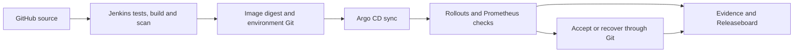

# DevOps auto-deployment and Releaseboard

A local software-release platform that builds and checks an application, evaluates
a new version, and verifies recovery when a controlled release fails.
**Releaseboard** brings build history, release health, analysis and evidence into
one dashboard.

**Current scope:** a working single-laptop demonstration and read-only product
foundation. User accounts, project onboarding and deployment actions in the
custom UI remain pending. This is not a production or high-availability setup.

## Supervisor review

- [Progress report - PDF, 24 October 2026](docs/reports/DevOps_Project_Progress_Report_2026-10-24.pdf)
- [Editable report source](docs/reports/supervisor-progress-report-2026-10-24.md)
- [Remaining milestones](docs/implementation-plan.md)

The report uses plain language and includes completed work, test results,
limitations and a five-minute demonstration guide.


## What is implemented

| Area | Working behaviour |
| --- | --- |
| CI pipeline | Jenkins checks trusted main-branch source, runs tests, builds an image, checks HIGH/CRITICAL vulnerabilities, exports a package inventory and publishes an exact image digest. |
| GitOps deployment | A separate environment repository stores desired configuration; Argo CD synchronizes it and Rollouts controls candidate promotion and traffic. |
| Release checks | Pre/post-promotion error and latency checks require sufficient traffic, exactly two healthy targets and fresh monitoring samples. |
| Recovery | A durable release lock and bounded worker restore earlier Git instructions and verify health. Failed recovery requires an explicit retry. |
| Persistence | Retained Prometheus data and an independent SQLite/SHA-256 evidence store, with integrity and backup/restore tooling. |
| Product backend | FastAPI/PostgreSQL, Alembic migration, reconciliation, audit records, signed/deduplicated event receipts and a pending outbox. |
| Custom UI | React overview, chronological release/build history, evidence search/downloads, recorded analysis and activity timeline. |

The demonstration application supports healthy, error, latency, readiness and
serving-only faults. A separate rolling-update baseline is preserved for comparison.



Jenkins owns builds; Git owns desired configuration; Argo CD owns synchronization;
Rollouts owns traffic selectors. The recovery worker restores through Git.
Releaseboard observes these sources. A successful build does not by itself mean
that a release has passed acceptance. Source delivery currently uses scheduled
GitHub polling rather than a public webhook.

## Run the existing lab

Use PowerShell from the repository root:

```powershell
.\scripts\lab.ps1 -Action start
.\scripts\lab.ps1 -Action review
.\scripts\lab.ps1 -Action status
```

| Address on the lab computer | Purpose |
| --- | --- |
| [localhost:8083](http://localhost:8083/) | Releaseboard |
| [localhost:8083/docs](http://localhost:8083/docs) | Product API documentation |
| [localhost:8081](http://localhost:8081/) | Small JSON demonstration application |
| [localhost:3100/rollouts](http://localhost:3100/rollouts/) | Native Argo Rollouts dashboard |
| [localhost:9090](http://localhost:9090/) | Prometheus monitoring |
| [localhost:8082](http://localhost:8082/) | Authenticated Jenkins |

These are local addresses, not public hosted links. `review` supervises application,
Rollouts and monitoring forwards. After portal setup, ordinary lab start/stop also
includes its API/database. Manage it separately with `portal-start`, `portal-stop`
and `portal-status`. Stop the managed lab without deleting its state:

```powershell
.\scripts\lab.ps1 -Action stop
```

## Setup and dependencies

The verified profile is Windows with Ubuntu 24.04/WSL, Docker Engine and a
single-node k3d/k3s cluster. The host has about 8 GiB RAM; services use conservative
limits. Node.js 24 was used for the frontend build. Tool/image pins are in
`versions.json`; product dependency versions are locked separately.

For a fresh machine, follow [Windows runtime setup](docs/windows-runtime.md),
[the lab runbook](docs/lab.md) and [CI/GitOps setup](docs/ci-gitops.md).
`bootstrap` is only for a fresh lab and refuses to replace an existing cluster.
Fresh-machine reproduction and a full controller rebuild from all locks remain pending.

For core tests and the demonstration app without the cluster:

```powershell
python -m venv .venv
.\.venv\Scripts\python.exe -m pip install -r requirements-validation.txt
.\.venv\Scripts\python.exe -m unittest discover -s tests -v
.\.venv\Scripts\python.exe -m demo.app
# Another terminal: curl.exe http://127.0.0.1:8080/
```

Reuse this venv. The lab's Linux venv is `/opt/release-lab/venv` (Python 3.12).
Windows core tests use Python 3.14. Docker/Kubernetes tools are separate installs.

### Build or update Releaseboard

With the existing lab and Linux venv available, from the repository root:

```powershell
wsl -d Ubuntu-24.04 -u root --cd "$PWD" --exec /opt/release-lab/venv/bin/python -m pip install -r apps/api/requirements.lock.txt
Set-Location apps/web
npm ci
npm run build
Set-Location ../..
.\scripts\lab.ps1 -Action portal-setup
.\scripts\lab.ps1 -Action portal-status
```

The API serves the compiled UI; a Node development server is not needed for
review. Setup preserves the labelled database/volume, applies migrations and
reloads the API service. Generated credentials remain in protected Linux files
outside the checkout. See [the portal runbook](docs/product-portal.md).

## Verification checkpoint - 24 October 2026

- 35 core tests passed.
- 8 API tests passed against PostgreSQL in isolated test schemas.
- 21 configuration documents passed schema and local-policy checks.
- The production frontend build passed.
- The live health check passed: the serving release was healthy and Jenkins was idle.

The 23 October API/database restart check retained 14 releases, 13 builds,
13 artifacts and 45 evidence records. This is local restart persistence, not
whole-host disaster recovery. Live release trials are described separately in
the supervisor report and [acceptance records](docs/post-promotion.md).

```powershell
.\.venv\Scripts\python.exe -m unittest discover -s tests -v
.\.venv\Scripts\python.exe -m scripts.validate_manifests
wsl -d Ubuntu-24.04 -u root --cd "$PWD" --exec env PORTAL_TEST_POSTGRES=1 /opt/release-lab/venv/bin/python -m unittest discover -s apps/api/tests -v
```

Product checks are separate from the lean demo CI job; wiring them into SCM CI
is outstanding. PostgreSQL tests create/remove only their randomly named schemas.

## Release safety and unfinished acceptance

**Pushing `main` can automatically trigger a real deployment.** Start the correct
observer before an intended release. Review branches do not match the configured
main-only job. Do not overlap publications or controlled trials.

Read [testing the current lab](docs/testing-current-lab.md) and
[the fault-matrix runbook](docs/gitops-fault-matrix.md) before live experiments.
The revised matrix is unfinished: latency rejection passed; the readiness pilot
recovered but failed its original evidence parser; the next attempt stopped on
a GitHub fetch timeout. Failed reports remain failed. Earlier engine-only checks
do not substitute for later Jenkins/GitOps acceptance.

Post-promotion recovery and denied-write/restart/retry have separate verified
experiments. The serving-only fault caused deliberate errors; it is not a claim
of zero downtime. Finite analysis windows do not establish permanent health.

## Next milestones

1. Finish end-to-end fault acceptance and infrastructure reproduction.
2. Add authentication/roles, onboarding, safe operator actions and product CI.
3. Add real notification delivery, staging and independent database/state backups.
4. Validate a separate build host, protected networking and shared operation.
5. Repeat measurements, reproduce on another machine and obtain user/supervisor acceptance.

The read API trusts the local operator and has no user login. The observer still
uses the lab admin kubeconfig. Shared use needs dedicated permissions. Existing
evidence backups do not cover the new PostgreSQL database or all host state.

## Repository guide

| Location | Contents |
| --- | --- |
| `apps/api/`, `apps/web/` | Product API, migrations/tests, React UI and dependency locks |
| `demo/`, `tests/` | Demonstration workload and core tests |
| `ci/` | Pipeline, bootstrap and locked controller plugins |
| `platform/`, `templates/` | Infrastructure and constrained release configuration |
| `scripts/` | Setup, lifecycle, recovery, evidence, validation and report generation |
| `docs/reports/` | Supervisor PDF and editable report source |
| `output/` | Ignored local observations, scans, backups and verification logs |

Read more: [architecture](docs/architecture.md), [persistence](docs/persistence.md),
[SCM validation](docs/scm-validation.md), [current review](docs/current-review.md),
and [third-party inventory](THIRD_PARTY.md).

Regenerate the report with a document-authoring Python environment containing
ReportLab: `python scripts/create_progress_report.py`. It writes to `output/pdf/`;
inspect it before updating the tracked `docs/reports/` copy. ReportLab is not a
product-runtime dependency.
