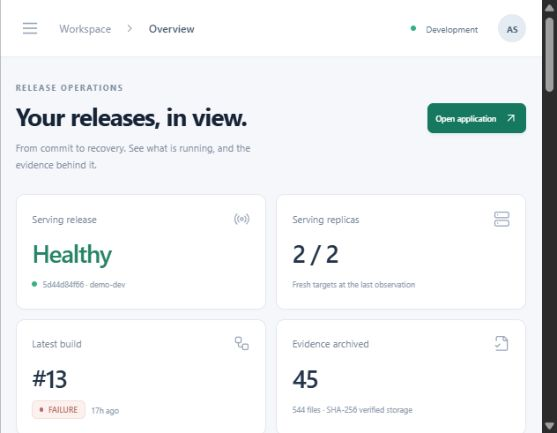

# DevOps auto-deployment
## Project progress report
Prepared for supervisor review | 24 October 2026

### What is this project?
This project helps a team move a software change from saved code to a running
application, check that the change behaves properly, and return to an earlier
working version when a tested release goes wrong.

### Where does it stand today?
A working demonstration system has been built on one Windows laptop using its
Linux environment. The release engine can build, check, publish and evaluate
software. A new dashboard brings the results together in one place.

> The project is a working local prototype. It is ready for a supervised demonstration of the completed features. It is not yet a finished, shared production service.

| Area | Current position |
| --- | --- |
| Running demonstration application | Healthy in the 24 October check; two copies are serving |
| Release and recovery engine | Implemented, with successful controlled experiments |
| Custom dashboard and database | Implemented as a read-only local foundation |
| User accounts and deployment buttons | Planned; not implemented yet |
| Complete final failure-test programme | Still unfinished |

### How to read this report
The next pages explain the problem, the work completed, the test evidence, the
remaining limitations, and the next milestones. Technical words are explained
in everyday language. All numbers describe named local checks, not promises
about every future deployment.

<!-- pagebreak -->

## 1. The problem and the proposed solution

### The problem
Updating an application by hand can involve many separate actions. Someone may
copy the wrong version, miss a test, or discover a fault only after people start
using the new version. It can also be difficult to explain exactly what happened
after a failed update.

### What the project aims to improve
- Repeat the same release steps instead of relying on memory.
- Check software before it becomes the version people use.
- Identify which saved code and application package belong to each release.
- Return to a previous working version when the tested recovery policy allows it.
- Keep reports showing both successful and failed experiments.
- Give the supervisor and operator one place to inspect progress.

### A simple example
Imagine that version A of an application is working. A developer prepares
version B. The system builds and checks B while A continues serving people.
If B passes the required checks, the system can switch to B. If a tested fault
appears after that switch, the system can return traffic and the saved release
instructions to A, then check that A is actually working again.

### What makes this an engineering project?
The engines are established tools, not new inventions. The project connects and
configures them, adds a small application with deliberate faults, implements a
durable recovery worker, stores evidence, and provides its own dashboard and
product database. Its contribution is the integration, safety rules, evidence
handling and measured demonstration on limited hardware.

> The aim is safer, more understandable releases. Automatic recovery does not mean that every failure can be repaired or that users will never see an error.

<!-- pagebreak -->

## 2. How a software update moves through the system

Each tool has one clear job. The dashboard observes these jobs; it does not
secretly replace their decisions.

| Step | In simple words | Tool or project component |
| --- | --- | --- |
| 1. Save the code | Keep the selected source version in the project repository. | GitHub and Git |
| 2. Build and check | Run code tests, package the application and scan its software packages for known serious problems. | Jenkins and Trivy |
| 3. Record the release | Save the exact application package identity and the instructions for the environment. | Local image store and separate environment Git repository |
| 4. Prepare the new version | Make the running environment follow those saved instructions. | Argo CD and Kubernetes |
| 5. Judge the candidate | Test the new version before switching users to it, then check its serving behaviour after the switch. | Argo Rollouts and Prometheus |
| 6. Confirm or recover | Confirm the accepted release, or restore the earlier instructions and verify recovery. | Project recovery worker and evidence store |

### Why keep the old and new versions separately?
The project uses a method called **blue/green deployment**. In plain words, the
working version and the candidate can run separately. A preview route is used
to check the candidate while the normal route continues to use the working
version. This makes the change easier to inspect and control.

### What is checked?
The rules look at application errors, response speed, enough test traffic,
two healthy application targets and recent monitoring samples. A missing result
must not be treated as proof that a release is good. Checks use a limited
observation window; they are not a promise of permanent future health.

### How does a release start?
Jenkins currently checks the main branch on a schedule. This is working source
polling, not an instant internet notification. A normal main-branch push can
therefore cause a real local build and release attempt.

<!-- pagebreak -->

## 3. Work completed in the release engine

| Completed work | What it gives the project |
| --- | --- |
| Local deployment laboratory | A working environment on the available laptop, with no separate cloud account required for this demonstration. |
| Small demonstration application | Healthy behaviour and deliberate error, slow-response, readiness and serving-only fault modes for controlled tests. |
| Build pipeline | Automated application tests, package creation, serious-vulnerability checks, package inventory and publication. |
| Exact package identification | A content-based identity records exactly which application package was released. |
| Separate release instructions | The desired environment is stored separately from application code and followed by the deployment tools. |
| Candidate and serving checks | Checks before and after the switch help distinguish a safe candidate from a release that fails only during normal use. |
| Durable recovery | Recovery intent survives a worker restart. The worker restores earlier instructions through a new Git record and checks the result. |
| Failed-recovery handling | Recovery is marked failed when verification or a required write cannot succeed. An explicit retry is required. |
| Release coordination | A saved release lock prevents a second publication from replacing an active or failed recovery. |
| Retained monitoring and evidence | Monitoring history and archived reports survive selected component restarts. Separate backup/restore checks have been demonstrated for earlier evidence and monitoring data. |

### Important recovery rule
Moving traffic back is only the first step. The worker must also confirm that
the saved instructions, running version, healthy response and recent monitoring
evidence agree. It requires repeated successful observations before declaring
recovery complete.

### A comparison has been preserved
A conventional rolling-update example remains available for comparison with
the blue/green approach. The project has not silently replaced an original
rolling-update requirement with a different technique.

<!-- pagebreak -->

## 4. The new dashboard and product database

The custom interface is called **Releaseboard**. It runs locally at
**http://localhost:8083/** and is separate from the native deployment-tool screen.

The dashboard image was captured on 23 October. Its healthy application card and failed latest-build card show different things: a failed new build does not automatically break the version already serving users.

### What can be viewed?
- **Overview:** the serving version, two serving copies, release checks and recovery state.
- **Builds and releases:** past results, source versions, durations and links to the existing tools.
- **Evidence:** searchable reports, security scans, package lists and downloadable observations.
- **Activity:** recorded changes and integration-event receipts that survive restarts.

### What works behind the screen?
A FastAPI backend collects information. PostgreSQL stores the product records.
The interface uses React. Signed integration receipts are checked for authenticity
and duplicate deliveries are handled safely. The screen identifies stale or
missing observations instead of presenting them as confirmed health.

> This version is read-only. It does not yet provide user login, project onboarding, promotion buttons or external notifications. Saved notification events remain pending until a real receiver is added.

<!-- pagebreak -->

## 5. Code checks and data-persistence evidence

### Automated checks
The verification checkpoint includes the following groups. These are checks of
code and configuration, not 43 complete live deployments.

| Check group | Result | What the result means |
| --- | --- | --- |
| Core tests | 35 passed | Checks of the small application, release logic, evidence handling and related utilities succeeded. |
| Product API tests on PostgreSQL | 8 passed | Checks included database setup, repeated observations, event signatures, duplicate events and protected evidence downloads. |
| Configuration checks | 21 documents passed | The selected deployment/configuration documents passed the available format and local-policy checks. |
| Frontend build | Passed | The new dashboard could be compiled into the files served by the local API. |

### What happened when the new components restarted?
PostgreSQL and the product API were restarted on 23 October. The following
record counts were the same before and after the restart:

| Stored record | Before | After |
| --- | --- | --- |
| Release records | 14 | 14 |
| Build records | 13 | 13 |
| Application package records | 13 | 13 |
| Archived evidence records | 45 | 45 |
| Existing activity / pending notification records | 1 / 1 | 1 / 1 |

This demonstrates local restart persistence for that checkpoint. It does not
prove recovery after the whole laptop or its disk is lost. Earlier monitoring
and evidence backup tests cover their own stores; they do not automatically
back up this new PostgreSQL database.

### Current review check
On 24 October, the lab health check passed with no attention conditions. The
running application was healthy, with two serving copies. Jenkins was idle.
The latest recorded build was build 13, which had failed before a new release
could be completed. The earlier working application remained available.

<!-- pagebreak -->

## 6. What the live experiments actually showed

The project has deliberately released faulty application versions in its local
lab. The results below come from different experiments and must not be added
together as one continuous availability measurement.

| Experiment | Observations | Honest interpretation |
| --- | --- | --- |
| Healthy GitHub-source release, build 1 | 2,845 serving requests; no failures recorded | Scheduled source polling and a healthy release completed automatically in this trial. |
| Faulty candidate, build 2 | 754 serving requests; no failures recorded | The candidate was rejected before it replaced the working version. |
| Slow-response candidate, build 12 | 1,012 serving requests; no failures recorded | The latency rule rejected the candidate and Git recovery restored the earlier desired state. |
| Serving-only fault, build 6 | 1,548 requests; 278 deliberate candidate errors | Preview passed, normal serving failed, then automatic traffic and Git recovery were verified. The observed error window was about 64 seconds. |
| Denied recovery write, build 7 | Failed recovery stayed failed across restart; explicit retry succeeded | A required write failure was not hidden or automatically called a success. |

### Experiments that remain failed or incomplete
The readiness-failure pilot kept serving the previous version and recovery
worked, with 3,301 serving requests and no failed responses recorded. However,
the first reporting check could not interpret the controller's saved timeout
evidence. That trial was kept as failed. The parser was corrected, but the next
full attempt stopped when Jenkins could not fetch code from GitHub.

The complete updated test programme still needs acceptance for readiness,
missing preview traffic, monitoring loss and the shared-dependency recovery
failure case. Earlier lower-level engine tests are useful evidence, but do not
replace this later end-to-end programme.

> The serving-only fault intentionally caused real failed requests. It is evidence of detection and recovery, not evidence of zero downtime. The roughly 64-second figure is the observed error window, not the total time for every recovery step.

<!-- pagebreak -->

## 7. Limits and the next milestones

### Limits that matter for supervisor review
- Everything currently runs on one physical laptop. Separate containers are not separate physical machines.
- The project has not demonstrated protection against losing that laptop or its disk.
- The dashboard is local and read-only. Shared access, user permissions and operator actions are not finished.
- Monitoring checks a finite release window. It does not prove that the application will remain healthy indefinitely.
- A failed shared dependency may also prevent the old version from working or prevent recovery from being verified.
- The complete revised failure-test programme and a clean installation on another machine are still unfinished.
- The new database needs its own backup and restore plan. External notification delivery is not connected.

### Recommended order of the remaining work

| Next milestone | Work to do | Evidence needed before accepting it |
| --- | --- | --- |
| 1. Finish engine acceptance | Complete the remaining end-to-end fault cases, investigate source-fetch reliability and verify infrastructure reproduction. | Retained passing/failing reports, healthy final state and repeatable setup. |
| 2. Add controlled product actions | User login and roles, project onboarding, safe operator actions, protection against conflicting requests and product checks in CI. | Tests showing that only the right user can make a change and duplicate/conflicting actions are handled safely. |
| 3. Prepare shared operation | Separate build host, protected network connections, staging, database/off-machine backups and actual notifications. | Restore trials, access checks and a second-person demonstration on real available infrastructure. |
| 4. Repeat and evaluate | Repeat fault and recovery measurements, compare deployment approaches and obtain supervisor/user feedback. | Repeatable measurements and clear acceptance decisions, not a single successful demonstration. |

### Cost and hardware position
The current local demonstration uses existing hardware and does not require a
new cloud subscription. This does not make electricity, storage, maintenance or
future shared infrastructure free. Any remote deployment needs an actual host
or account and a separate resource decision.

<!-- pagebreak -->

## 8. A simple supervisor demonstration

The student should start the existing lab and its local review services before
the meeting. All addresses below work on the same computer as the lab. They
are not public website links.

| Open this address | What to look for |
| --- | --- |
| http://localhost:8083/ | Releaseboard overview: healthy serving version, latest build result and evidence count. |
| http://localhost:8081/ | The small application response showing its service, revision and healthy mode. This is a test workload, not the product dashboard. |
| http://localhost:3100/rollouts/ | The native release-tool view: working/candidate versions and recorded analysis. |
| http://localhost:9090/ | Monitoring data for the application copies. |
| http://localhost:8082/ | Jenkins login and build history. Authentication is required; credentials are not included in this report. |

### Suggested five-minute walkthrough
1. Open Releaseboard and explain which application version is serving.
2. Show that the latest failed build and the healthy serving version can coexist.
3. Open release history and compare an accepted release with a rejected candidate.
4. Search the evidence records and open one report, scan or observation file.
5. Show the activity timeline and explain what is still planned.

Do not start a new deliberate-failure experiment just to open the dashboard.
Those tests need a separate controlled session and time for recovery. The full
serial failure programme can take about 45 to 60 minutes.

### Suggested supervisor decisions
- Is the completed local release-and-recovery demonstration clear enough?
- Is blue/green deployment accepted as an extension alongside the rolling-update comparison?
- Should the next effort focus on unfinished engine acceptance or authenticated product actions?
- What additional evidence or demonstration is required for the next review?

### A suitable statement of progress
The local release engine and the read-only product foundation are working.
Selected recovery behaviour has been demonstrated with retained evidence.
The project still needs complete end-to-end acceptance and shared-user features.

<!-- pagebreak -->

## 9. Plain-language glossary and evidence guide

| Word | Simple meaning in this project |
| --- | --- |
| Build | Turn a chosen source-code version into a package that can run. |
| Release / deployment | Put a chosen version into a running environment under the release rules. |
| Candidate | The new version being checked before it is fully accepted. |
| Replica | Another running copy of the same application. |
| Rollback / recovery | Return to earlier working software or instructions, then check the result. |
| Container | A packaged process with its own settings; it still shares the physical host. |
| Git / GitOps | Keep change history; use saved, reviewed instructions as the desired running setup. |
| API / backend | The service behind the dashboard that supplies and stores information. |
| Database | Organised storage for product records such as builds, releases and activity. |
| Digest / checksum | A content-based fingerprint used to identify a package or check an archived file. |
| Read-only | Information can be inspected, but this UI cannot change a deployment. |
| Failure matrix | A planned list of different fault cases that must be tested separately. |

### Where the report's evidence comes from
The source repository is **github.com/muhaddasgujjar/devops-auto-deployment**.
The readable source for this report and a copy of the PDF are included under
**docs/reports/**. The exact report checkpoint is the Git commit containing them.

- **docs/post-promotion.md:** serving-fault recovery and denied-write retry history.
- **docs/scm-validation.md:** actual GitHub/Jenkins delivery and candidate rejection.
- **docs/product-portal.md:** product scope, tests, persistence and limitations.
- **docs/gitops-fault-matrix.md:** the revised test programme and its required outcomes.
- **docs/implementation-plan.md:** remaining work and acceptance gates.
- **output/portal-restart-check.json:** local database/API restart receipt.
- **output/supervisor-*.log:** verification logs for this review, retained locally.

The large raw evidence and private runtime state are deliberately kept outside
the published source snapshot. The PDF contains no passwords, private keys or
authentication tokens. Failed experiments remain failed in the underlying records.
